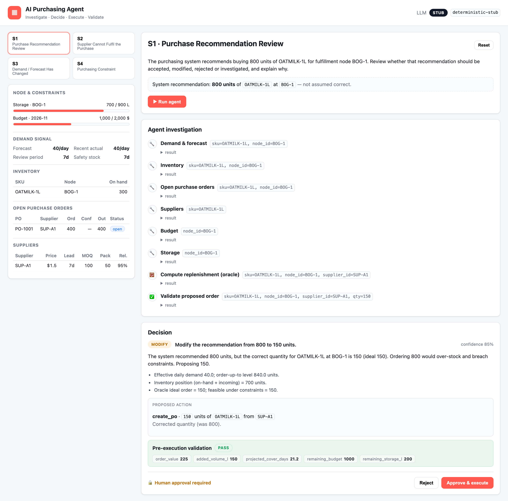
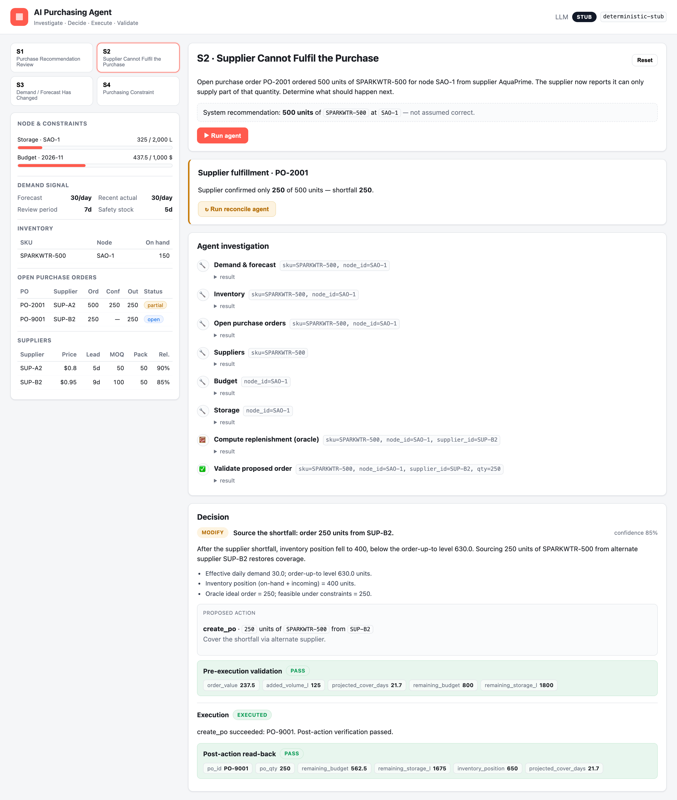
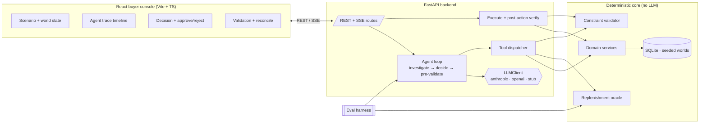

# AI Purchasing Agent

An AI agent that assists a quick‑commerce **buyer**: it takes a purchasing
situation, **investigates** the relevant data, **decides** what to do
(accept / modify / reject / investigate / escalate), **proposes an action**
behind a human‑approval gate, **executes** it, and then **validates the
outcome** — reconciling when reality differs from what it expected.

> The goal is not a chatbot that answers purchasing questions. It is a system
> that **makes, executes, and validates** purchasing decisions.

**Core idea:** the LLM *orchestrates, reasons, and explains*; deterministic code
*computes and validates*. The agent never does inventory arithmetic in its head —
it calls a deterministic **replenishment oracle** and a **constraint validator**.
The same oracle is reused by the evaluation harness as independent ground truth.

The recommendation handed to the agent is **never assumed correct** — the seed
data is deliberately built so the right answer differs from what the system
recommended.

---

## Demo at a glance

**Scenario 1 — the system recommends 800 units; the agent investigates and modifies it to 150** (it would otherwise breach budget and storage and overstock a perishable):



**Scenario 2 — the supplier can only fulfil 250 of a 500‑unit PO; the agent reconciles by sourcing the shortfall from an alternate supplier, executes it, and the post‑action read‑back passes:**



---

## What it covers

| # | Scenario | Implemented | Correct outcome (oracle‑derived) |
|---|----------|-------------|----------------------------------|
| **S1** | Purchase recommendation review | **End‑to‑end** | Recommendation 800 → **modify to 150**; 800 breaches budget + storage |
| **S2** | Supplier cannot fulfil the PO | **End‑to‑end** (feedback loop) | Review → covered; after partial confirm → **source 250 from alternate supplier** |
| **S3** | Demand / forecast changed | Eval + API | Recent sales ≈3× forecast → **buy more** (existing PO no longer covers demand) |
| **S4** | Purchasing constraint | Eval + API | Budget caps the ideal order → **order the feasible partial + escalate** the gap |

S1 and S2 are the deep, UI‑driven flows. S3 and S4 run through the same agent,
tools and engine, and are exercised by the evaluation harness.

---

## Architecture



**Agent lifecycle:** `investigate → reason → decide → propose → (human approve) → execute → verify → reconcile`.

See [docs/architecture.md](docs/architecture.md) for the full data flow, the
oracle math, and the decision policy.

---

## The feedback & validation loop (the important part)

Validation happens at **three** points, and the loop closes when reality
diverges from expectation:

1. **Pre‑execution validation.** Before the agent proposes an order it calls
   `validate_purchase_order`. Hard violations (over budget, over storage, below
   MOQ, wrong pack multiple, supplier doesn't offer the SKU) force it to reduce
   the order, switch supplier, or escalate — it can never propose an invalid order.

2. **Execution‑time re‑validation.** When a human approves, the system
   re‑validates against the *current* world (which may have changed since the
   proposal). If it no longer passes, execution is **blocked** rather than
   silently committing a bad order.

3. **Post‑action read‑back.** After the PO is written, the system re‑reads the
   resulting world and re‑asserts the invariants (committed spend ≤ budget,
   occupied volume ≤ capacity, coverage sane). Residual shortfall or overstock
   surfaces as a warning instead of being ignored.

4. **Reconcile when the outcome differs from expected.** Scenario 2 is the
   headline: a PO expected **500** units, the supplier confirms **250**. The
   `/api/suppliers/confirm` event records the shortfall; the agent re‑enters the
   loop in *reconcile* mode, recomputes the gap, and sources it from an alternate
   supplier (or escalates if infeasible).

Because the **replenishment oracle is pure and deterministic**, both the agent
(as a tool) and the evaluator (as ground truth) agree on what "correct" means —
that is what makes the agent's decisions checkable and the system reliable.

---

## Setup & run

**Prerequisites:** Python 3.11+ (tested on 3.14) and Node 18+ (tested on 25).

### 1. Backend (FastAPI)

```bash
cd backend
python3 -m venv .venv && source .venv/bin/activate
pip install -r requirements.txt
cp .env.example .env            # defaults to the offline stub — no API key needed
uvicorn app.main:app --reload --port 8000
```

The database auto‑seeds on startup. API docs live at `http://localhost:8000/docs`.

### 2. Frontend (React)

```bash
cd frontend
npm install
npm run dev                     # http://localhost:5173  (proxies /api → :8000)
```

Open **http://localhost:5173**, pick a scenario, and click **Run agent**.

### 3. Choosing the LLM (pluggable)

The agent is provider‑agnostic. Edit `backend/.env` and restart the backend:

```ini
LLM_PROVIDER=stub         # deterministic, offline, no key (DEFAULT)
# LLM_PROVIDER=anthropic  # ANTHROPIC_API_KEY=sk-...   ANTHROPIC_MODEL=claude-opus-4-8
# LLM_PROVIDER=openai     # OPENAI_API_KEY=sk-...       OPENAI_MODEL=gpt-4o
```

The **stub** is a real tool‑using agent — it just makes deterministic choices
instead of calling a model — so the whole demo and the evaluation run end‑to‑end
with **no API key**, and the evals are reproducible. Switching to `anthropic` or
`openai` swaps only the reasoning engine; the tools, constraints, oracle, and
feedback loop are identical.

---

## Evaluation

```bash
cd backend
python -m evals.run_evals          # offline stub (deterministic, default)
python -m evals.run_evals --live   # uses the provider configured in .env
pytest                             # 15 unit tests for the oracle + validator
```

The harness runs the agent against each fixture and checks the assignment's
criteria. It derives the expected quantity from the **oracle**, independently of
the agent, so the checks stay honest and robust to seed changes:

| Check | Question it answers |
|-------|--------------------|
| `decision`    | Was the decision category correct? |
| `info`        | Did the agent obtain the necessary information? (required tools in the trace) |
| `constraints` | Did it respect relevant constraints? (proposed order passes hard validation) |
| `action`      | Did it take the appropriate action? (create / none / escalate) |
| `qty`         | Does the quantity match oracle ground truth (within tolerance)? |
| `validated`   | Did it validate the result — and is failure handled? |

Sample output (offline stub):

```
case                                       cat        decis info  const actio qty   valid  result
-------------------------------------------------------------------------------------------------
S1-review-overrecommendation               modify     ✓     ✓     ✓     ✓     ✓     ✓      PASS
S2-review-covered                          accept     ✓     ✓     ✓     ✓     ✓     ✓      PASS
S2-reconcile-partial-fulfilment            modify     ✓     ✓     ✓     ✓     ✓     ✓      PASS
S3-demand-spike                            modify     ✓     ✓     ✓     ✓     ✓     ✓      PASS
S4-constraint-blocks-full-order            escalate   ✓     ✓     ✓     ✓     ✓     ✓      PASS
S3-blocked-execution-when-budget-shrinks   modify     ✓     ✓     ✓     ✓     ✓     ✓      PASS

6/6 cases passed.
```

The last case is the **failure path**: after the agent proposes a valid order,
the budget collapses; execution‑time re‑validation must **block** the stale
order. This demonstrates "what happens when the initial action does not work."

**Verified live:** the suite passes **6/6 on OpenAI `gpt-4o`** (`--live`),
reproducibly across repeated runs, as well as 6/6 on the offline stub.

Because LLM output is non‑deterministic, the checks assert **semantic
equivalence classes**, not exact wording — this is deliberate and was shaped by
watching live runs:

- `accept` and `reject` are both accepted when they lead to **no order**
  (the action is what matters, not the label).
- `create_po` and `modify_po` are both accepted for adding quantity.
- Quantity is judged against the **band of correct answers across suppliers**
  (the right amount is lead‑time dependent and the agent may pick any valid
  supplier), which still rejects genuine errors like ordering 800 or 0.
- "Necessary info" = demand + inventory + open orders + `compute_replenishment`
  (which itself folds in supplier terms, budget and storage).

This is the point of the harness: it distinguishes *defensible variation* from
*real mistakes*. Early live runs surfaced the agent occasionally punting to
`investigate` or over‑ordering on a "do nothing" case — both were fixed by
tightening the system prompt, not by loosening the checks.

---

## Mock data & domain model

Everything is mocked in a seeded SQLite database (`backend/app/seed.py`). Each
scenario is a self‑contained "world" tagged by `scenario_id` and individually
resettable from the UI.

Entities: **Product** (unit cost, storage volume, shelf life), **Node**
(storage capacity), **Supplier** + **SupplierOffer** (price, lead time, MOQ,
pack size, reliability), **Inventory** (on‑hand), **DemandForecast** (+ review
period, safety stock), **SalesHistory** (recent actuals), **PurchaseOrder**
(ordered / confirmed / received / status), **Budget** (amount / committed).

The agent reaches this data only through **tools** (`backend/app/agent/tools.py`)
that call mock domain services (`backend/app/domain/`) — the same shape a real
integration with inventory / ERP / supplier APIs would take.

---

## Design decisions & trade‑offs

- **LLM proposes, code disposes.** Quantities and constraint checks are
  deterministic and unit‑tested. The LLM chooses *what to investigate* and *how
  to frame the decision*, not the numbers. This is the single biggest
  reliability lever.
- **Human‑in‑the‑loop by default.** The agent only ever *proposes* a write; a
  person approves before any PO is created or modified. Escalation is a
  first‑class decision category.
- **Offline‑first.** The deterministic stub makes the system fully runnable and
  the evals reproducible without secrets, while real providers plug in via one
  env var.
- **In‑process run registry.** Pending decisions live in memory — fine for a
  single‑process demo; a queue/DB would replace it in production.
- **Scope.** S1 + S2 are deep and UI‑driven; S3 + S4 share the architecture and
  are covered by evals. Breadth was traded for a solid core and feedback loop.

---

## Other buyer problems this architecture fits

The same agent + oracle + validator + feedback loop generalizes to:
**open‑PO monitoring**, **supplier reliability** (already modelled, surfaced as a
warning), **alternate sourcing** (S2), **forecast anomalies / demand spikes**
(S3), **replenishment & safety stock** (the oracle), and **constraint‑aware
buying** (S4). Each is a new *situation* + seed, not new plumbing.

---

## Project structure

```
backend/
  app/
    engine/        # replenishment oracle + constraint validator (pure, tested)
    domain/        # mock domain APIs: world reads + PO writes
    agent/         # llm clients (anthropic/openai/stub), tools, prompts, loop
    api/routes.py  # REST + SSE endpoints
    service.py     # run registry + execute + post‑action verification
    seed.py        # four seeded scenario worlds
  tests/           # pytest unit tests for the engine
  evals/           # evaluation harness + fixtures
frontend/          # Vite + React + TS buyer console
docs/              # architecture write‑up + screenshots
```

---

## Tech

Python · FastAPI · SQLModel/SQLite · Anthropic & OpenAI SDKs · React · Vite ·
TypeScript. No build infra required; mock APIs and data throughout.
