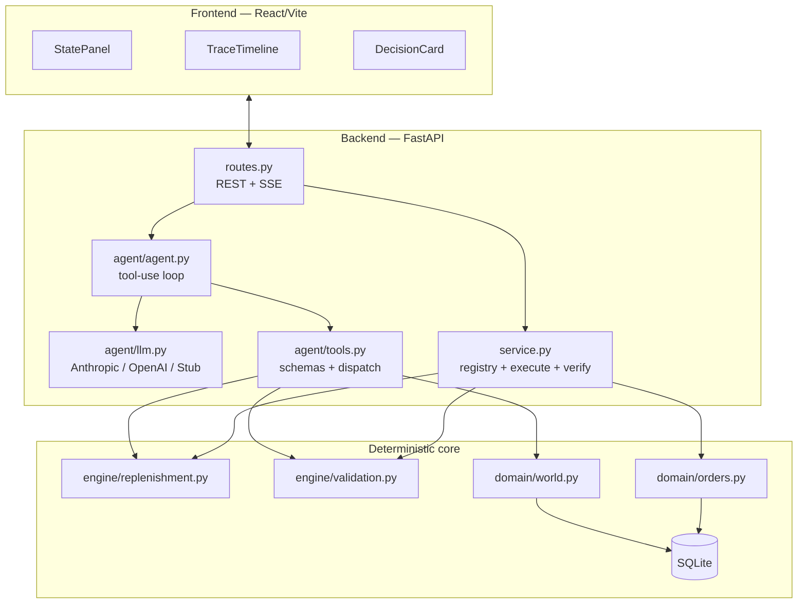
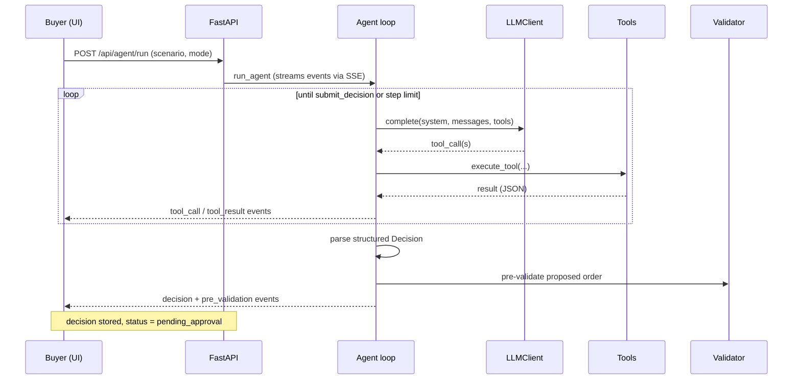
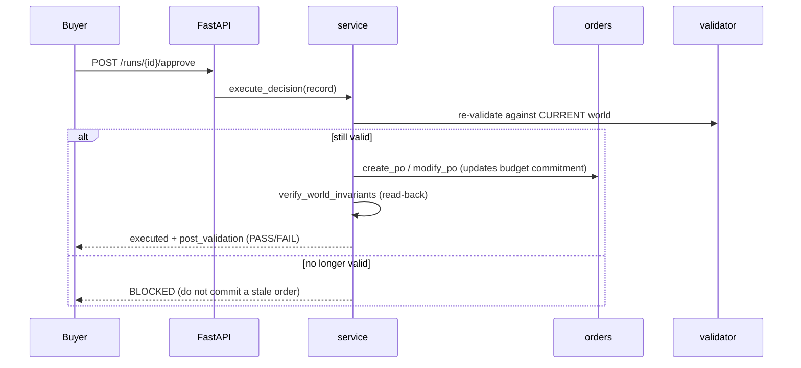

# Architecture & Design

This document explains how the AI Purchasing Agent is put together: the data
flow, the deterministic decision engine, the agent loop, the tool catalog, and
the feedback/validation loop. For setup and the demo, see the top‑level
[README](../README.md).

---

## 1. Design principle: LLM orchestrates, deterministic code computes

The central reliability decision is a strict separation of concerns:

| Concern | Owner | Why |
|---------|-------|-----|
| *What* to investigate, *how* to frame/justify the decision | **LLM** | Judgement, language, handling ambiguity |
| *How much* to order, *whether* constraints hold | **Deterministic code** | Must be correct, auditable, testable |

The LLM calls `compute_replenishment` and `validate_purchase_order` as tools; it
never computes quantities itself. The identical oracle is used by the evaluation
harness as **ground truth**, so "is the agent right?" has a precise, independent
answer.

---

## 2. Component view



---

## 3. The replenishment oracle (`engine/replenishment.py`)

A classic **order‑up‑to (base‑stock)** policy, pure and I/O‑free:

```
effective_daily_demand = 0.7 * recent_actuals + 0.3 * forecast   # falls back to forecast
order_up_to_level      = effective_daily_demand * (lead_time + review_period)
                         + effective_daily_demand * safety_stock_days
inventory_position     = on_hand + incoming(open/partial POs)
raw_need               = order_up_to_level - inventory_position
```

Then:

1. If `raw_need ≤ 0` → recommend **0** (already covered).
2. Round `raw_need` **up** to satisfy MOQ and pack‑size multiples → `recommended_qty` (the constraint‑free ideal).
3. Clamp by **budget** (`remaining_budget / unit_price`) and **storage**
   (`remaining_storage / unit_volume`), each rounded **down** to a whole pack →
   `constrained_qty`.
4. If the clamp forces the order below MOQ → **infeasible** (needs escalation,
   not a silent sub‑MOQ order).

The result carries the ideal and feasible quantities, the binding constraints,
projected days of cover, and a full numeric breakdown. Weighting recent actuals
is what makes the policy respond to the Scenario‑3 demand spike.

Why this blend of forecast and actuals, these coverage horizons, and the
round‑up/round‑down asymmetry are the main modelling choices — all are in one
small, unit‑tested module so they are easy to inspect and change.

---

## 4. The validator (`engine/validation.py`)

Separates **hard violations** (must not place) from **soft warnings** (place,
but flag):

- **Hard:** supplier doesn't offer SKU · non‑positive qty · below MOQ · not a
  pack multiple · over remaining budget · over remaining storage.
- **Soft:** supplier reliability below threshold · projected cover exceeds shelf
  life (spoilage) · cover above target (overstock) · cover below target
  (still short).

`ok = (no hard violations)`. The same function is used pre‑execution,
execution‑time, and (adapted) in the post‑action read‑back.

---

## 5. Agent loop (`agent/agent.py`)



The agent is given **read** tools, two **analysis** tools, and one **terminal**
tool, `submit_decision` — but **no write tools**. Executing a PO happens only
after human approval, outside the loop. The loop is identical across providers;
each `LLMClient` only translates messages/tools to its SDK format.

### Tool catalog (`agent/tools.py`)

| Kind | Tools |
|------|-------|
| Read | `get_product`, `get_inventory`, `get_demand`, `get_open_orders`, `get_suppliers`, `get_budget`, `get_storage` |
| Analysis | `compute_replenishment`, `validate_purchase_order` |
| Terminal | `submit_decision` → `{category, summary, reasoning, key_factors[], proposed_action, confidence}` |

---

## 6. Decision policy

The agent (and the deterministic stub, which mirrors the system prompt) maps the
oracle output to a disposition:

| Situation | Category | Action |
|-----------|----------|--------|
| `raw_need ≤ 0` (already covered) | **accept** | none |
| Order warranted, matches recommendation | **accept** | create_po |
| Order warranted, differs from recommendation | **modify** | create_po (corrected qty) |
| Reconcile: cover a supplier shortfall | **modify** | create_po (alternate supplier) |
| Constraint caps the order below ideal | **escalate** | create_po (feasible partial) + flag the gap |
| No MOQ‑compliant order possible | **escalate** | escalate |
| Insufficient information | **investigate** | none |

---

## 7. Execution & the feedback loop (`service.py`)



**Reconcile trigger (Scenario 2):** `POST /api/suppliers/confirm` records a
partial fulfilment (ordered 500, confirmed 250 → PO becomes `partial`, the
unfulfilled commitment is freed). The UI then starts a *reconcile* agent run; the
oracle now sees the reduced inventory position and the agent sources the gap from
the alternate supplier — the "outcome differs from expected → handle it" path.

---

## 8. Reliability notes

- **Determinism where it matters.** All arithmetic and constraint logic is pure
  and unit‑tested (15 tests); the stub makes end‑to‑end behaviour reproducible.
- **No invalid writes.** Three validation points plus an execution‑time block
  prevent committing an order that violates constraints.
- **Budget/storage accounting stays consistent** across create/modify/cancel/
  confirm so the post‑action read‑back reflects the true world.
- **Bounded agent loop** (`AGENT_MAX_STEPS`) with a safe fallback decision if the
  model never calls `submit_decision`.
